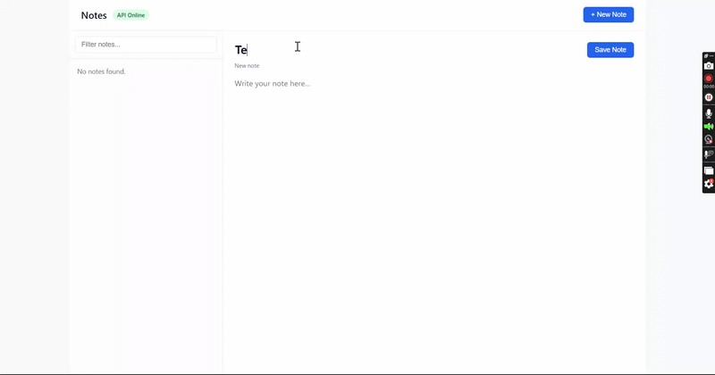
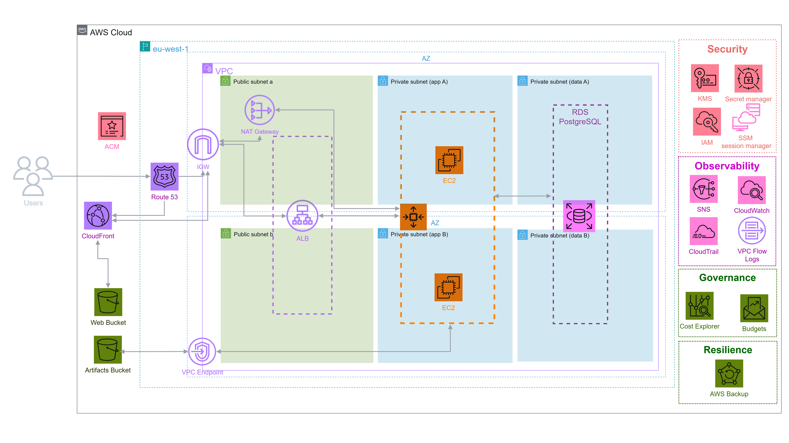

<div align="center">

# Multi-tier-notes-app: Production-Ready Multi-Tier Notes App on AWS

**A highly available, secure, observable 3-tier web application, built and operated entirely with the AWS CLI.**

[](#tech-stack)
[](#well-architected-alignment)
[](#deployment-runbook)
[](LICENSE)

[Architecture](#architecture) · [Runbook](#deployment-runbook) · [Results](#results-at-a-glance) · [Key design decision](#key-design-decisions-and-trade-offs) .  [Lessons learned](#challenges-and-lessons-learned)




</div>

---

## Overview

A note-taking web app deployed across two Availability Zones with CloudFront, an ALB, an Auto Scaling group, and an encrypted private RDS PostgreSQL database. I built it to practice designing for security, reliability and cost, and to show I can operate cloud infrastructure from the command line and document it so another engineer can reproduce it.

**Why the AWS CLI?** To understand exactly what each AWS resource does and in what order before abstracting it with Terraform.

> **Note — CloudFront & Custom Domain / TLS Temporarily Deferred:**  
> Amazon CloudFront is currently unavailable on this account due to an account verification issue; a support case has been submitted to AWS Support. The corresponding AWS CLI commands are already written in the deployment scripts and commented out—uncomment and run them once CloudFront becomes available, is created, and is configured. In production, a custom domain name, Amazon Route 53, and an AWS Certificate Manager (ACM) certificate will be added.

## Results at a glance

| Metric | Result | How it was measured |
|---|---|---|
| Availability design | 2 AZs, no single point of failure in the app tier | Terminated an instance under load: **3.09%** failed requests - [screenshot](docs/imgs/availability.png)|
| Load test | **55.5 req/s** sustained, p95 **661.99 ms**, **0%** errors | k6, 8 min, [screenshot](docs/imgs/load-test.png) |
| Auto Scaling | 2 → 3 instances in 1 min at 50% CPU | [screenshot](docs/imgs/autoscaling-dashboard.png) |
| DB failover (Multi-AZ demo) | **48.5 s** | RDS reboot with failover - `docs/RDS-Failover-runbook.md` |
| Restore test | **29 min** to restore from PITR | [script](runbook/RDS-restore-test.sh) (measures T0 and T-available) |
| Time to deploy from scratch |**~20 min** | `runbook/deploy.sh` |
| Monthly cost (24/7) | ≈ **$92.8** | Cost Explorer filtered by `Project=[name]` |
| Security scan | **0 critical findings** | [Prowler report](docs/prowler_security_audit_report.md) *note: two critacal finds in the report but for hradware MFA and administrator Account* |

## Architecture




**Request flow**

1. The browser resolves `[notes.yourdomain.com]` (Route 53) to CloudFront over TLS 1.2+.
2. Static assets are served from a **private** S3 bucket through Origin Access Control.
3. `/api/*` is forwarded to the ALB over HTTPS with a secret header. The ALB returns **403** to anything without it, and its security group accepts only CloudFront's managed prefix list.
4. Instances in private subnets run the Flask API, fetch DB credentials from Secrets Manager, and connect to RDS over verified TLS.
5. The data tier has **no internet route**.

## Tech stack

| Layer | Service | Why this choice |
|---|---|---|
| Edge | Route 53, CloudFront, ACM | TLS, caching, DDoS baseline, single domain (no CORS) |
| Web | S3 + OAC | Cheap, durable, no servers to patch |
| App | ALB + Auto Scaling group (EC2 `t4g.micro`, Amazon Linux 2023) | Graviton cost saving, rolling replacement, self-healing |
| Data | RDS PostgreSQL (gp3, encrypted) | Managed backups, PITR, optional Multi-AZ |
| Security | KMS CMK, Secrets Manager, IAM, SSM Session Manager | No hard-coded secrets, no SSH |
| Observability | CloudWatch, CloudTrail, VPC Flow Logs, SNS | Metrics, logs, audit trail, alerts |
| Resilience | AWS Backup | Tag-driven daily backups |
| Governance | AWS Budgets, cost allocation tags | Cost guardrails |
| App | python Flask, PostgreSQL, vanilla JS |  |

## Well-Architected alignment

| Pillar | What I did |
|---|---|
| **Security** | Three-tier network isolation; least-privilege IAM; CMK encryption (RDS, secrets, artifacts); TLS everywhere; IMDSv2 only; no SSH or bastion; ALB reachable only via CloudFront |
| **Reliability** | 2 AZs; ASG with ELB health checks; RDS backups + PITR (Multi-AZ optional); tested restore; documented RPO/RTO |
| **Performance efficiency** | CloudFront caching; Graviton instances; target-tracking scaling on CPU; gp3 storage |
| **Cost optimization** | Single NAT and single-AZ DB by default (documented trade-off); S3 gateway endpoint; Budgets alerts; `Project` tag for cost attribution |
| **Operational excellence** | Scripted, ordered runbook; dashboards and alarms; rolling instance refresh for patching.|

## Key design decisions and trade-offs


| Decision | Alternatives considered | Why | Trade-off accepted |
|---|---|---|---|
| CloudFront in front of ALB, locked with a secret header + prefix list | Public ALB | Blocks direct-to-origin attacks and bypassing caching | Extra header to rotate |
| Single NAT gateway | One per AZ | ~$35/month saved | AZ-a failure cuts outbound access (not inbound traffic) |
| RDS single-AZ by default | Multi-AZ | Halves DB cost for a portfolio | Documented failover test with Multi-AZ enabled temporarily |
| SSM Session Manager instead of SSH | Bastion host | No open ports, full audit log | Needs SSM agent and NAT/endpoints |
| EC2 + ASG instead of containers/Lambda | ECS Fargate, Lambda | Demonstrates classic 3-tier ops (patching, scaling, LB) | More operational work |
| S3 Gateway VPC Endpoint for traffic & artifacts | NAT Gateway for S3 / Interface endpoint | Zero data-processing cost; keeps artifact downloads and S3 traffic off public NAT/internet | Only works for S3 within the same region; requires route table entries |
| Customer-managed KMS keys (CMKs) with auto-rotation | AWS-owned / default encryption keys | Granular IAM key policies, auditability, and compliance readiness | Extra key management overhead and potential cross-service policy setup |
| Secrets Manager + IAM instance profile | Hardcoded credentials or `.env` files on EC2 | Centralized secret rotation and no static access keys stored on disk | Slight per-secret/API cost and runtime dependency on Secrets Manager |
| Observability stack (CloudWatch, CloudTrail, VPC Flow Logs) | Minimal/default logging only | End-to-end audit trail, packet/flow visibility, and ASG/alarm telemetry | Added storage/ingestion costs and more alerts/logs to tune |
| Bash + AWS CLI automation scripts | Terraform / CloudFormation / AWS CDK | Fast, transparent provisioning with direct CLI control and zero state-file drift | More imperative scripting required; idempotency and drift checks are manual |
| UUID primary keys for notes | Sequential integer IDs (`SERIAL`/`BIGINT`) | Prevents ID enumeration and avoids collisions across distributed writes | Slightly larger index/storage footprint and less human-readable URLs |
| Deferring CloudFront / ACM / Route 53 until account verification clears | Blocking deployment or exposing direct ALB indefinitely | Keeps core backend/ASG/RDS validation moving while AWS Support resolves verification | Temporary lack of edge caching/HTTPS custom domain until CLI steps are uncommented |

## Security highlights

- [x] No public IPs on app or data tiers; DB has `PubliclyAccessible=false`
- [x] Security groups reference each other (no CIDR-based trust between tiers)
- [x] DB password is RDS-managed in Secrets Manager; the instance role can read **only that secret**
- [x] Encryption at rest (KMS CMK, rotation on) and in transit (TLS 1.2+, verified DB TLS)
- [x] CloudTrail (multi-region, log validation) and VPC Flow Logs enabled
- [x] Prowler results: [link](docs/prowler_security_audit_report.md)

## Repository structure

```text
.
├── README.md
├── app/                    # Python Flask API (app.py)
│   ├── app.py
│   ├── notesapp.service
│   ├── requirements.txt 
│   └── dist
│       ├── app.js
│       ├── index.html
│       └── style.css              
├── runbook/
│   ├── env.sh              # variables: region, project, domain
│   ├── 01-network.sh       # VPC, subnets, routing, NAT, endpoints
│   ├── 02-security.sh      # KMS, security groups, IAM role/profile
│   ├── 03-data.sh          # buckets, RDS, secret policy
│   ├── 04-compute.sh       # launch template, target group, ASG
│   ├── 05-edge.sh          # ALB, ACM, CloudFront notes, Route 53
│   ├── 06-observability.sh # alarms, SNS, flow logs, CloudTrail, Backup
│   ├──RDS-restore-test     # RDS PITR test
│   └──deploy-all.sh
├── docs/
│   ├── RDS-Failover-runbook.md                # measured RTO
│   ├── prowler_security_audit_report.md       # prowler security scan report
│   ├── teardown_guide.md                      # teardown guide                          
│   └── img/
└── LICENSE
```

## Prerequisites

- AWS account with an admin-capable identity (IAM Identity Center; root unused and MFA-protected)
- AWS CLI v2 (`aws --version`), Python 3.9+, pip, a virtual environment (venv), and Flask (plus a WSGI server like Gunicorn and required environment variables/services for production).
- A registered domain with a Route 53 hosted zone
- Region: `[eu-west-1]` (CloudFront certificates are requested in `us-east-1`)

## Deployment runbook

```bash
git clone https://github.com/aziz-nasri/Multi-tier-notes-app.git && cd [repo]
# edit region, project name, domain etc in env.sh
./runbook/deploy.sh                       # or run the numbered scripts one at a time
# resquest certificate for domains in ACM
# create and configure CloudFront and Route 53
```

| Stage | Script | What it creates | Time |
|---|---|---|---|
| 3.1 Foundation | `01-network.sh`, `02-security.sh` | VPC, subnets, NAT, route tables, SGs, KMS, IAM |
| 3.2 Data | `03-data.sh` | S3 buckets, encrypted RDS, secret access policy |
| 3.3 Compute | `04-compute.sh` | Launch template (IMDSv2, encrypted EBS), target group, ASG + scaling policy |
| 3.4 Edge | `05-edge.sh` | ACM certs, ALB with header-locked listener rule |
| 4 Operations | `06-observability.sh` | Alarms, SNS, CloudTrail, Flow Logs, Backup plan, Budget |


**Tear down** 

(stops all charges): `./docs/teardown_guide.md`

## Verification

```bash
curl -I https://[notes.yourdomain.com]                     # 200
curl https://[notes.yourdomain.com]/api/health             # ok
curl -k https://[origin.yourdomain.com]/api/health         # 403: direct ALB access is blocked (When CloudFront is available)
```

## Observability

| Alarm | Condition | Action |
|---|---|---|
| ALB 5xx | ≥ 10 in 5 min | SNS email |
| Unhealthy hosts | > 0 for 1 min | SNS email |
| p95 latency | ≥ 1.5 s for 15 min | SNS email |
| RDS CPU / free storage | > 80% / < 5 GiB | SNS email |
| RDS connections | ≥ 100 for 5 min | SNS email |
| NAT port allocation error | ≥ 1 for 5 min | SNS email |
| Budget | ≥ 80% | Email |
| cost anomaly detection | ≥ $50 | Email |

Logs: ALB, application and RDS logs in CloudWatch (30-day retention), Flow Logs/CloudTrail in S3 (90-day lifecycle).

## Backup and disaster recovery

| Scenario | Strategy | RPO | RTO (measured) |
|---|---|---|---|
| Instance or AZ loss (app tier) | ASG replaces instances across AZs | 0 | 1 min |
| Database failure | Multi-AZ failover (when enabled) | 0 | 48.5 s |
| Data corruption / accidental delete | Point-in-time restore | ≤ 5 min | 29 min |

Restore procedure and evidence: `runbook/RDS-restore-test.sh` - `docs/RDS-Failover-runbook.md` - `docs/imgs/autoscaling-dashboard.png`

## Cost

| Item | Monthly (24/7) | Notes |
|---|---|---|
| NAT Gateway + Public IPv4 | ≈ $38.6 | Biggest line item; single NAT |
| ALB | ≈ $18.15 | |
| EC2 (2 × t4g.micro) | ≈ $14.73 | |
| RDS (db.t4g.micro + 20 GB gp3) | ≈ $15.32 | Multi-AZ doubles this |
| Other (CloudFront, S3, KMS, logs, Route 53) | ≈ $6 | |
| **Total** | **≈ $92.8** | |


## Challenges and lessons learned


1. **Frontend Stuck on "Checking API..." & DOM Null Errors**
   - **Problem:** The UI remained stuck on `Checking API...` while throwing `Uncaught TypeError: Cannot read/set properties of null` in `app.js`, even though `/api/health` returned `200 OK`.
   - **Root Cause:** `app.js` executed before the HTML DOM was parsed (or referenced mismatched element IDs), causing `document.getElementById()` to return `null` when attaching event listeners and updating status/toast elements.
   - **Fix:** Deferred script execution (`defer` / placing `<script>` at the bottom of `<body>`) and aligned the DOM element IDs between HTML and `app.js`, then uploaded the updated frontend assets to the S3 artifact bucket and triggered an EC2 Auto Scaling Group instance refresh.

2. **404 Not Found on Note Deletion (`DELETE /api/notes/<uuid>`)**
   - **Problem:** Clicking delete on a note returned `404 (NOT FOUND)` from the backend.
   - **Root Cause:** The Flask `DELETE` route was defined with an integer path converter (`/api/notes/<int:note_id>`), whereas the application generates and sends UUID strings for note IDs, preventing Flask from matching the route.
   - **Fix:** Updated the Flask route converter from `<int:note_id>` to `<uuid:note_id>` (casting `str(note_id)` for the SQL query and checking `cursor.rowcount`), pushed the updated backend code to the S3 artifact bucket, and initiated an ASG instance refresh to roll out the change.

3. **AWS CLI Profile Not Found**
   - **Problem :** aws sts get-caller-identity failed when resolving the AWS CLI profile.
   - **symptom:** `aws: [ERROR]: The config profile (Aziz) could not be found`
   - **Root cause :** --profile Aziz was used while no Aziz profile existed in ~/.aws/config or ~/.aws/credentials.
   - **Fix :** Checked active environment variables (env | grep -i aws) and existing profiles (aws configure list-profiles), then configured the Aziz profile.

4. **Redirecting systemd Service Logs Under Security Hardening**
   - **Problem :** Routing Flask application logs to /opt/notes/app.log from a hardened systemd unit running as notes:notes.
   - **symptom:** Logs were not written to /opt/notes/app.log, or writing to /opt/notes risked permission/read-only filesystem issues under ProtectSystem=full.
   - **Root cause :** StandardOutput and StandardError were not configured to append to /opt/notes/app.log, and ProtectSystem=full makes the filesystem read-only unless /opt/notes is explicitly allowed for writes.
   - **Fix :** Added StandardOutput=append:/opt/notes/app.log, StandardError=append:/opt/notes/app.log, and ReadWritePaths=/opt/notes under [Service], ensured /opt/notes and /opt/notes/app.log are owned by notes:notes, start an instance refresh in the ASG.

5. **HTTP 500 on `PUT /api/notes/<uuid>` in update_note**
   - **Problem :** Updating a note via `PUT /api/notes/<uuid>` failed with an unhandled server exception.
   - **symptom:** Browser received 500 (INTERNAL SERVER ERROR), and CloudWatch/Flask logs showed psycopg2.ProgrammingError: can't adapt type 'UUID' at cursor.execute(...) in update_note (app.py, line 78).
   - **Root cause :** Flask's `<uuid:note_id>` converter passed a Python uuid.UUID object directly to psycopg2.extras.RealDictCursor.execute(...) without converting it to a string first (unlike delete_note, which cast str(note_id)).
   - **Fix :** Updated update_note to cast note_id_str = str(note_id) before cursor.execute(...), safely parse JSON (request.get_json(silent=True) or {}), handle missing rows (404), and roll back on errors (conn.rollback()) before returning the connection to db_pool. reuploaded app files to the artifact bucket and start an instance refresh in the ASG.


## Known limitations and roadmap

- [ ] Port the runbook to **Terraform** for repeatable, reviewable infrastructure
- [ ] CI/CD with GitHub Actions and OIDC (no long-lived keys)
- [ ] One NAT gateway per AZ and Multi-AZ RDS for production
- [ ] Authentication (Amazon Cognito) with per-user note ownership
- [ ] Containerise and move to ECS Fargate; compare cost and ops effort
- [ ] Cross-region backup copy and a tested regional failover
- [ ] AWS WAF managed rules and rate limiting on CloudFront

## Skills demonstrated

AWS (VPC, EC2, Auto Scaling, ELB, RDS, S3, CloudFront, Route 53, ACM, IAM, KMS, Secrets Manager, Systems Manager, CloudWatch, CloudTrail, AWS Backup, Budgets) · Linux · Bash · python · PostgreSQL · Networking and security design · High availability and disaster recovery · Monitoring and alerting · Cost optimization · Technical documentation · Well-Architected Framework

## About me

**Mohamed Aziz Nasri**: aspiring Cloud/DevOps/SRE engineer
[LinkedIn](www.linkedin.com/in/aziz-nasri-8142ba434) · [Email](aziz.nasri.dev@gmail.com)

Licensed under the [MIT License](LICENSE).

