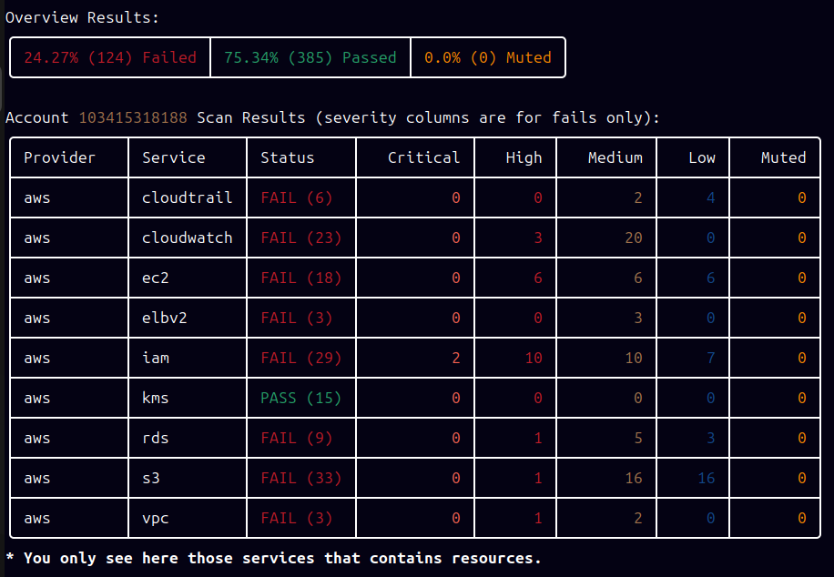
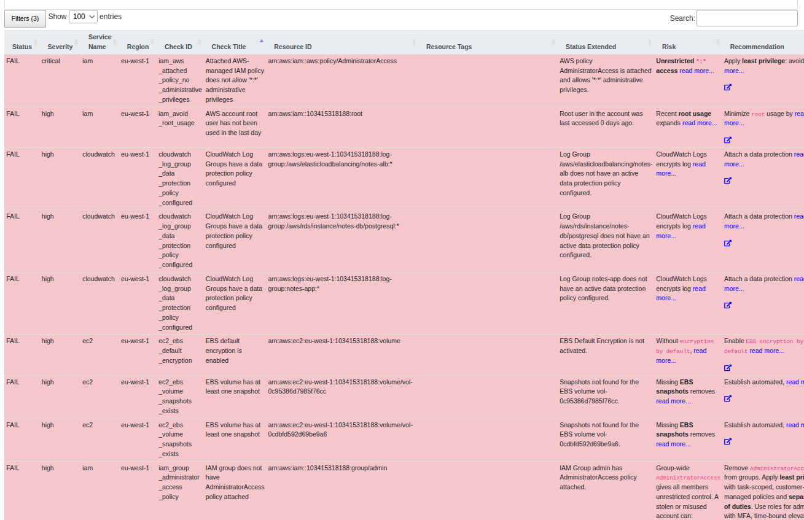

# AWS Security Posture Assessment — Prowler Audit Report

**Project:** `notesapp`  
**AWS Account ID:** `103415318188`  
**Target Region:** `eu-west-1` (plus global IAM checks)  
**Audit Tool:** Prowler CLI  
**Assessment Date:** November 20, 2026  

---

## 1. Executive Summary

An automated cloud security posture assessment was conducted against the `notesapp` AWS infrastructure using **Prowler** to evaluate IAM, networking, encryption, logging, compute, storage, and database configurations against AWS security best practices.

* **Total Checks Executed:** `509`
* **Passed:** `385` (**75.34%**)
* **Failed:** `124` (**24.27%**)
* **Muted:** `0` (**0.0%**)

Overall, the environment demonstrates a solid baseline—highlighted by **100% pass rate across all KMS encryption checks (`15/15`)**—while identifying **2 Critical** and **22 High** severity findings concentrated primarily in **IAM** and **EC2** that require prioritized triage.

---

## 2. Methodology & Execution Steps

### Step 1: Isolated Environment & Tool Installation
A dedicated Python virtual environment was created to install Prowler cleanly without dependency conflicts:

```bash
python3 -m venv ~/prowler-venv
source ~/prowler-venv/bin/activate
pip install --upgrade pip
pip install prowler
prowler -v
```

### Step 2: AWS CLI Profile & Identity Verification
Before executing the scan, the active AWS CLI profile and read-only auditing identity (`SecurityAudit` / `ViewOnlyAccess`) were verified to ensure the scan targeted the intended account:

```bash
export AWS_PROFILE=<audit-profile>
aws sts get-caller-identity
```

### Step 3: Targeted Infrastructure Scan Execution
To focus on the active deployment region (`eu-west-1`) and core services used by the `notesapp` architecture, a scoped scan was executed with multi-format reporting (`csv`, `html`, and `json-ocsf`):

```bash
prowler aws \
  --region eu-west-1 \
  --service iam ec2 vpc kms cloudtrail cloudwatch rds s3 elbv2 \
  -M csv html json-ocsf \
  -o ~/prowler-reports/notesapp
```

### Step 4: Report Generation & Review
The generated HTML and CSV artifacts in `~/prowler-reports/notesapp` (as well as the CLI summary table) were reviewed to categorize findings by service and severity (`Critical`, `High`, `Medium`, `Low`).

---

## 3. Test Results & Screenshots

### 3.1 CLI Scan Overview Output
> **Screenshot Placeholder:** Replace the path below with the relative path to your saved CLI summary screenshot (e.g., `docs/images/prowler-summary.png`).



### 3.2 Prowler HTML / Dashboard Report View
> **Screenshot Placeholder:** Add a screenshot of the filtered `FAIL` findings from your generated `.html` report or `prowler dashboard`.



### 3.3 Results Breakdown by AWS Service

| Provider | Service | Status | Critical | High | Medium | Low | Muted |
| :--- | :--- | :--- | :---: | :---: | :---: | :---: | :---: |
| `aws` | **iam** | `FAIL (29)` | **2** | **10** | 10 | 7 | 0 |
| `aws` | **s3** | `FAIL (33)` | 0 | **1** | 16 | 16 | 0 |
| `aws` | **cloudwatch** | `FAIL (23)` | 0 | **3** | 20 | 0 | 0 |
| `aws` | **ec2** | `FAIL (18)` | 0 | **6** | 6 | 6 | 0 |
| `aws` | **rds** | `FAIL (9)` | 0 | **1** | 5 | 3 | 0 |
| `aws` | **cloudtrail** | `FAIL (6)` | 0 | 0 | 2 | 4 | 0 |
| `aws` | **elbv2** | `FAIL (3)` | 0 | 0 | 3 | 0 | 0 |
| `aws` | **vpc** | `FAIL (3)` | 0 | **1** | 2 | 0 | 0 |
| `aws` | **kms** | `PASS (15)` | 0 | 0 | 0 | 0 | 0 |
| **Total** | **9 Services** | **385 Pass / 124 Fail** | **2** | **22** | **64** | **36** | **0** |


## 4. Interpretation of Findings

### 4.1 Key Strengths
* **KMS Encryption Posture (`15/15 Passed`):** All Customer Managed Keys (CMKs) and KMS key policies passed every check (such as key rotation and access policy controls), confirming strong cryptographic key management.
* **Zero Critical Findings Across Data, Network & Compute Layers:** No `Critical` severity issues were detected in `ec2`, `rds`, `vpc`, `elbv2`, `s3`, `cloudtrail`, or `cloudwatch`.

### 4.2 Service-by-Service Analysis

1. **Identity & Access Management (`iam` — 2 Critical, 10 High, 10 Medium, 7 Low):**
   * **Interpretation:** IAM represents the highest-priority risk area because IAM configurations are global across the account. `Critical` and `High` findings in Prowler typically indicate root account hardening gaps (e.g., MFA or hardware MFA checks, root access keys), IAM user password policies, unused credentials/access keys, or overly permissive IAM policies (`*` actions/resources).
   * **Action:** Inspect the `2 Critical` and `10 High` IAM checks first to verify root account protection and enforce least-privilege IAM roles for EC2 and administrative users.

2. **EC2 Compute & Security Groups (`ec2` — 0 Critical, 6 High, 6 Medium, 6 Low):**
   * **Interpretation:** `High` findings in EC2 commonly point to permissive Security Group ingress rules (such as `0.0.0.0/0` exposure on management ports), IMDSv2 enforcement on instances/Launch Templates, or unencrypted EBS volumes/snapshots.
   * **Action:** Confirm that application EC2 instances only accept traffic from the ALB Security Group, enforce IMDSv2 (`HttpTokens=required`), and verify EBS default encryption.

3. **Amazon S3 (`s3` — 0 Critical, 1 High, 16 Medium, 16 Low):**
   * **Interpretation:** Although S3 has the highest raw failure count (`33`), almost all findings are `Medium` and `Low`. Because Prowler evaluates every S3 bucket in the account, a few buckets lacking server access logging, object versioning, MFA delete, or explicit TLS-only bucket policies can generate multiple Medium/Low alerts.
   * **Action:** Remediate the single `High` finding first (typically public access block or bucket policy exposure), then harden the `notesapp` artifact bucket with versioning, default encryption, and `aws:SecureTransport` enforcement.

4. **CloudWatch Monitoring (`cloudwatch` — 0 Critical, 3 High, 20 Medium, 0 Low):**
   * **Interpretation:** CloudWatch failures frequently stem from missing CIS benchmark log metric filters and alarms (e.g., alerts for unauthorized API calls, root account usage, IAM policy changes, or Security Group modifications) as well as log group retention periods.
   * **Action:** Review the `3 High` findings and add metric filters/alarms for critical security events alongside defined log retention policies.

5. **Relational Database Service (`rds` — 0 Critical, 1 High, 5 Medium, 3 Low):**
   * **Interpretation:** `High` RDS findings generally relate to public accessibility or encryption at rest, while `Medium`/`Low` items cover deletion protection, automated backup retention periods, Multi-AZ deployment, and minor version auto-upgrades.
   * **Action:** Confirm `notes-db` is strictly isolated in private subnets (`PubliclyAccessible=false`) and encrypted with KMS, and document any intentional lab trade-offs (such as disabling deletion protection or Multi-AZ outside testing windows to control costs).

6. **VPC, ALB & CloudTrail (`vpc`, `elbv2`, `cloudtrail` — 1 High, 7 Medium, 4 Low combined):**
   * **Interpretation:**
     * **VPC (`1 High, 2 Medium`):** Typically flags missing VPC Flow Logs, unrestricted default security groups, or network ACL rules.
     * **ELBv2 (`3 Medium`):** Commonly flags HTTP-only listeners (lack of HTTPS/TLS termination and HTTP-to-HTTPS redirect), ALB access logging, or deletion protection.
     * **CloudTrail (`2 Medium, 4 Low`):** Usually reflects log file integrity validation, CloudWatch Logs integration, or S3 access logging on the trail bucket.
   * **Action:** Ensure VPC Flow Logs are enabled on the `notesapp` VPC, restrict the default VPC security group, and plan HTTPS/ACM certificate integration on the ALB for production readiness.

---

## 5. Prioritized Remediation & Triage Plan

| Priority | Target Scope | Action Item |
| :---: | :--- | :--- |
| **P1 (Immediate)** | `iam` (2 Critical, 10 High) | Audit root account MFA/access keys, enforce strong password policy, and tighten overly broad IAM role/user policies. |
| **P2 (High)** | `ec2` (6 High), `s3` (1 High), `rds` (1 High), `vpc` (1 High) | Verify EC2 Security Group isolation & IMDSv2, lock down any public S3 permissions, confirm RDS private-only access/encryption, and validate VPC Flow Logs. |
| **P3 (Medium)** | `cloudwatch` (3 High, 20 Med), `elbv2` (3 Med), `cloudtrail` (2 Med) | Configure security metric alarms, enable CloudTrail log validation, and add HTTPS listener + access logs on the ALB. |
| **P4 (Document)** | Intentional Lab Exceptions | Document non-production trade-offs (e.g., Single-AZ RDS or disabled deletion protection during testing) using a Prowler mutelist (`--mutelist-file`) for clean baseline tracking. |